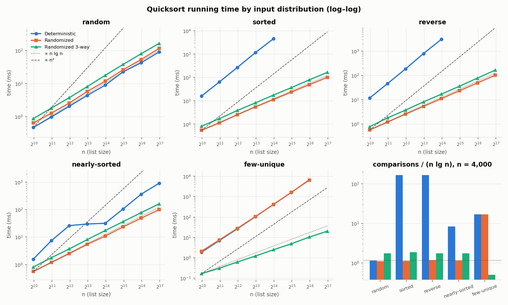
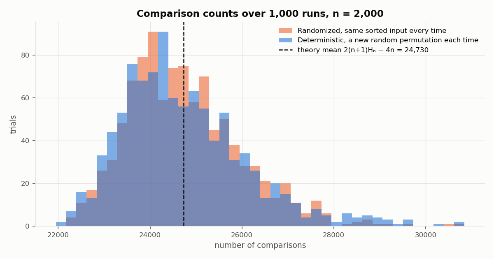

# MSCS532 Assignment 5: Quicksort

This repository contains:

* Deterministic Quicksort (last-item pivot, Lomuto partition).
* Randomized Quicksort (uniformly random pivot).
* As an extension, a randomized three-way Quicksort for inputs with many equal keys.
* A benchmark comparing them on random, sorted, reverse-sorted, nearly-sorted and
  few-unique inputs, by running time, comparison counts and recursion depth.

The algorithms follow *Introduction to Algorithms* (Cormen et al., 4th ed., ch. 7). The full
write-up, covering design choices, best/average/worst-case analysis, space complexity, the
effect of randomization and discussion of results, is in **[REPORT.md](REPORT.md)**.

| File | Contents |
|---|---|
| `quicksort.py` | `quicksort`, `randomized_quicksort`, `randomized_quicksort_3way`, the partition functions, and `QuickSortStats` |
| `run_benchmarks.py` | Running times, comparison counts, comparison-count distribution, and recursion depth |
| `test_quicksort.py` | 13 unit tests |
| `chart_style.py` | Shared graph styling |
| `results/` | CSV data, graphs and terminal output from the last full run |

## Requirements

You need Python 3.8 or later. The algorithms and tests use only the standard library. The
graphs need `matplotlib`:

```bash
pip install matplotlib
```

## Running the code

```bash
python3 -m unittest -v test_quicksort
```

```bash
python3 quicksort.py
```

```bash
python3 run_benchmarks.py
```

```bash
python3 run_benchmarks.py --quick
```

* `python3 quicksort.py` sorts a small example with all three versions and shows the
  recursion depth on sorted input.
* `python3 run_benchmarks.py` runs the full benchmark (about 1 minute) and writes the CSV
  files, graphs and `benchmark_output.txt` to `results/`.
* `--quick` uses smaller sizes and finishes in about 5 seconds.

Using the functions directly:

```python
import random
from quicksort import quicksort, randomized_quicksort, QuickSortStats

data = [5, 3, 8, 1, 9, 2]
quicksort(data)                                   # sorts in place, also returns data
randomized_quicksort(data, rng=random.Random(42)) # reproducible random pivots

stats = QuickSortStats()
quicksort(list(range(1000)), stats=stats)
print(stats)   # QuickSortStats(partitions=999, max_depth=998, max_stack=1)
```

## Summary of findings

### Complexity

| | Deterministic | Randomized |
|---|---|---|
| Best | Θ(n lg n) | Θ(n lg n) |
| Average / expected | Θ(n lg n), about 1.39 n lg n comparisons on random input | Θ(n lg n) expected on **every** input |
| Worst | Θ(n²), exactly n(n−1)/2 comparisons, on sorted and reverse input | Θ(n²) with probability ≤ 2ⁿ⁻¹/n! for the full worst case |
| Extra space | O(1) data + O(lg n) stack (smaller-side recursion) | same |

The average case is 2(n+1)H<sub>n</sub> − 4n comparisons. Keys z<sub>i</sub> < z<sub>j</sub>
are compared exactly when one of them is the first pivot chosen from z<sub>i</sub>..z<sub>j</sub>,
which has probability 2/(j−i+1). Summing over all pairs gives about 2n ln n.

### Measured (median ms)

| n = 16,000 | random | sorted | reverse | nearly-sorted | few-unique |
|---|---:|---:|---:|---:|---:|
| Deterministic | 9.0 | **4,507.6** | **3,081.9** | 31.8 | **408.7** |
| Randomized | 11.9 | 11.3 | 11.0 | 10.9 | **410.4** |
| Randomized 3-way | 17.8 | 17.5 | 16.9 | 17.3 | 2.5 |

* **Deterministic Quicksort hits its worst case on sorted and reverse input.** It makes
  exactly n(n−1)/2 comparisons, and its time grows 4.0–4.1× per doubling of n. On 16,000
  sorted items it is about 400× slower than the randomized version.
* **Randomized Quicksort performs the same on every input order.** Its time grows about 2.1×
  per doubling of n, and it makes 1.09–1.18 n lg n comparisons whatever the input. That
  matches the theoretical 1.15 n lg n at n = 4,000.
* **Randomized Quicksort on one sorted input behaves like deterministic Quicksort on random
  input.** Over 1,000 runs at n = 2,000 the mean comparison counts were 24,747 and 24,736,
  against 24,730 predicted, and the histograms coincide. The worst run was only 1.25× the
  mean.
* **Randomization has a small cost.** On input that is already random, the extra random
  number per partition makes the randomized version 15–30% slower.
* **Randomization does not fix duplicate keys.** With only 10 distinct values, both two-way
  versions are quadratic (about n²/20 comparisons). Three-way partitioning sorts that input in
  linear-looking time, 2.5 ms instead of about 410 ms.
* **Smaller-side recursion keeps the stack at most lg n deep.** The textbook recursion tree
  is n − 2 deep on sorted input, which would crash Python at n ≈ 1,000.




