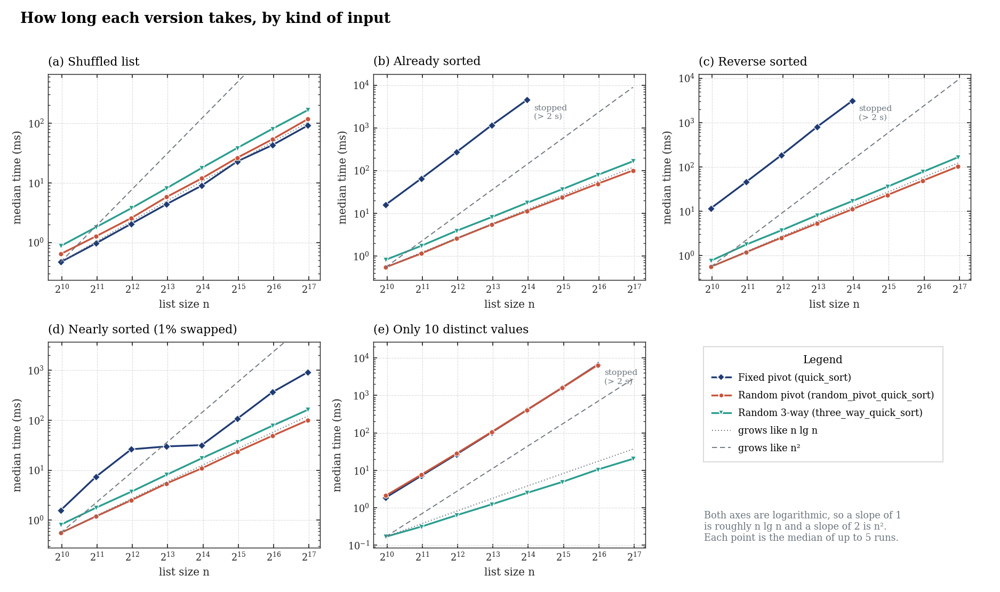
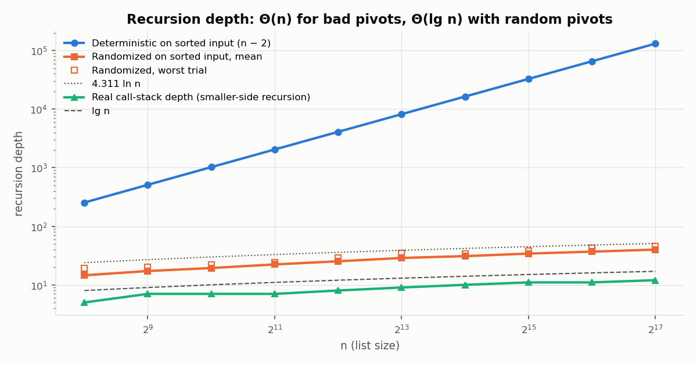

# Quicksort: Implementation, Analysis, and Randomization

MSCS532 Assignment 5

I ran everything with Python 3.13.9 on an Apple Silicon Mac. All the numbers in this report
come from [`results/benchmark_output.txt`](results/benchmark_output.txt), which you can
regenerate with `python3 run_benchmarks.py`. The comparison counts, recursion depths and the
Part 3 histogram use a fixed seed (532), so they come out exactly the same every time. The
timings will move around by a few percent between runs.

## Contents

1. [Implementation](#1-implementation)
2. [Performance analysis](#2-performance-analysis)
3. [Randomized Quicksort](#3-randomized-quicksort)
4. [Empirical analysis](#4-empirical-analysis)
5. [Conclusions](#5-conclusions)
6. [References](#6-references)

---

## 1. Implementation

All the code is in [`quicksort.py`](quicksort.py). I based it on QUICKSORT, PARTITION and
RANDOMIZED-QUICKSORT from Cormen et al. (2022, ch. 7). The book uses 1-based arrays, so I
switched to 0-based indexes with inclusive ranges, `items[start..end]`.

| Function | How the pivot is picked | How the list is split |
|---|---|---|
| `quick_sort(items)` | always the last item, `items[end]` | Lomuto (`lomuto_split`) |
| `random_pivot_quick_sort(items, rng=None)` | a random item from `items[start..end]` | swap that item to the end, then Lomuto (`random_split`) |
| `three_way_quick_sort(items, rng=None)` | a random item | Dijkstra's three-way split (`three_way_split`) into `<`, `==` and `>` |

The assignment only asks for the first two. I added the third one after running the
benchmarks: both of the first two versions turn quadratic on lists with lots of repeated values,
no matter how the pivot is picked (section 4.4). The three-way version fixes that.

### 1.1 How quick sort works

It's a divide-and-conquer algorithm with three steps:

1. **Divide.** Pick a pivot and rearrange `items[start..end]` so that everything to the left of
   the pivot's final position `mid` is `<=` the pivot, and everything to the right is bigger.
2. **Conquer.** Sort `items[start..mid-1]` and `items[mid+1..end]` recursively.
3. **Combine.** There's nothing to do here. Both halves were sorted in place, and they're
   already in the right order relative to each other.

### 1.2 The Lomuto split

```python
def lomuto_split(items, start, end):
    pivot = items[end]
    boundary = start - 1
    for scan in range(start, end):
        if items[scan] <= pivot:
            boundary += 1
            items[boundary], items[scan] = items[scan], items[boundary]
    items[boundary + 1], items[end] = items[end], items[boundary + 1]
    return boundary + 1
```

At the top of each loop iteration the list looks like this:

```
 start   boundary  boundary+1   scan-1  scan           end
 [   <= pivot   ][    > pivot       ][ not checked  ][pivot]
```

When the loop finishes, the "not checked" part is empty, and one last swap drops the pivot in
between the two groups. The loop makes exactly `end - start` comparisons, so splitting n items
takes Θ(n) time and O(1) extra space.

### 1.3 The random split

```python
def random_split(items, start, end, rng=random):
    pick = rng.randint(start, end)
    items[pick], items[end] = items[end], items[pick]
    return lomuto_split(items, start, end)
```

All it adds is one random number and one swap per split. Everything else is shared with the
fixed-pivot version, so when I compare their timings in section 4, the only thing that differs is
how the pivot gets chosen.

### 1.4 Design decisions

* **Recursing only into the smaller half.** The book's version calls itself on both halves.
  On a sorted list every split is (n−1, 0), so the call stack ends up n levels deep, and Python
  throws a `RecursionError` at around 1,000. To get around that, `_sort_range` and
  `_sort_range_3way` recurse only on the smaller half and handle the bigger half with a `while`
  loop (CLRS problem 7-4). The splits are exactly the same as the book's version, so the
  comparisons and running time don't change. The only difference is that the worst-case stack
  depth drops from O(n) to O(lg n). Without this I couldn't have measured the n² worst case past
  about 1,000 items.
* **In place, but still returning the list.** Every version sorts the list it's given and also
  returns it, so `quick_sort(data[:])` can be used just like `sorted(data)`.
* **Only comparison operators.** The two-way versions only use `<=` and the three-way one only
  uses `<`. That means anything comparable can be sorted, and it also let me count comparisons
  in the benchmark by wrapping the values in a class that increments a counter.
* **An optional `rng` argument.** For the random versions you can pass `random.Random(seed)`
  and get the same run every time. The tests and Part 3 of the benchmark depend on that.
* **An optional `SortTracker`.** It records how many times the list was split
  (`split_calls`), the deepest level of the recursion tree (`deepest_level`, which is how deep
  the book's version would have to go on the stack) and how deep the real Python stack got
  (`deepest_stack`). It only gets updated once per split, not on every comparison, so it barely
  costs anything.

### 1.5 Tests

[`test_quicksort.py`](test_quicksort.py) has 13 tests (`python3 -m unittest -v
test_quicksort`). They check:

* all three sorts against `sorted()` on awkward cases (an empty list, one item, all items
  equal, negative numbers, floats), 18 random lists, a list with only 4 distinct values, and an
  almost-sorted list;
* sorting strings and tuples;
* that the list is sorted in place and the same object is returned;
* that the split functions leave the list correctly split and only move items inside
  `items[start..end]`;
* that the random pivot is fair, meaning each of 10 positions comes up within 1.5% of 1/10 over
  20,000 tries;
* that the fixed-pivot sort on a sorted list makes exactly n − 1 splits with a recursion tree
  n − 2 levels deep, while the real stack never goes past 1 frame;
* that the real stack depth stays at or under lg n + 1 for n = 4,096;
* that sorting 5,000 already-sorted items doesn't hit Python's recursion limit;
* that on a list of identical values the two-way split needs n − 1 splits and the three-way
  split needs only 1.

---

## 2. Performance analysis

Let T(n) be the running time on n items and C(n) the number of comparisons. Each level of
recursion costs whatever the split costs, which is Θ(m) for a part of size m. A split of m items
makes exactly m − 1 comparisons, so C(n) and T(n) grow the same way, and I use comparisons for
the analysis below.

### 2.1 Worst case: Θ(n²)

The worst case is when every split is as lopsided as it can be: the pivot is the smallest or
biggest value, leaving n − 1 items on one side and none on the other.

$$
T(n) = T(n-1) + T(0) + \Theta(n) = T(n-1) + \Theta(n)
\;\Rightarrow\; T(n) = \sum_{m=1}^{n} \Theta(m) = \Theta(n^2).
$$

Counting comparisons exactly:

$$
C(n) = (n-1) + (n-2) + \dots + 1 = \frac{n(n-1)}{2}.
$$

When the last item is always the pivot, this is exactly what happens on a **sorted** list,
since the pivot is always the maximum. It also happens on a **reverse-sorted** list. There, the
first split puts the minimum at the front and moves the maximum to the end, so the next pivot is
the maximum, and the splits keep alternating between (0, n−1) and (n−1, 0). At n = 4,000 I
measured exactly n(n−1)/2 = 7,998,000 comparisons for both (section 4.3).

O(n²) is also an upper bound for every input. The recursion tree can't have more than n − 1
splits, and none of them costs more than n.

### 2.2 Best case: Θ(n lg n)

The best case is when every pivot is the median, so the two halves have ⌊(n−1)/2⌋ and
⌈(n−1)/2⌉ items:

$$
T(n) = 2T(n/2) + \Theta(n) \;\Rightarrow\; T(n) = \Theta(n \lg n)
$$

by case 2 of the master theorem. The recursion tree has lg n levels, and the splits on each
level handle at most n items in total.

The splits don't actually have to be perfect. Even a 9-to-1 split every time gives

$$
T(n) = T(9n/10) + T(n/10) + \Theta(n).
$$

Each level still costs at most cn, and the longest path down the tree has length
log<sub>10/9</sub> n = Θ(lg n), so T(n) is still O(n lg n). You only get quadratic behaviour
when the smaller side keeps shrinking to almost nothing compared to n, like (n−1, 0).

No comparison-based sort can beat Ω(n lg n) in the worst case. A decision tree with n! leaves
has height at least lg(n!) = Θ(n lg n). So the best case is Θ(n lg n).

### 2.3 Average case: Θ(n lg n)

Assume all the values are distinct and every ordering of the input is equally likely. As
section 3 explains, that's the same thing as picking the pivot at random. Call the values in
sorted order z<sub>1</sub> < z<sub>2</sub> < … < z<sub>n</sub>, and let Z<sub>ij</sub> =
{z<sub>i</sub>, …, z<sub>j</sub>}.

The trick is to notice that two values only get compared when one of them is the pivot, and once
a value has been a pivot it's never compared again. So z<sub>i</sub> and z<sub>j</sub> are
compared at most once, and they're compared only if z<sub>i</sub> or z<sub>j</sub> is the first
pivot picked out of Z<sub>ij</sub>. If some z<sub>k</sub> in between (i < k < j) gets picked
first, it sends z<sub>i</sub> and z<sub>j</sub> to opposite sides and they never meet. Until
something from Z<sub>ij</sub> gets picked, all of Z<sub>ij</sub> stays together in the same
part, and each of its j − i + 1 values is equally likely to go first. So:

$$
\Pr[z_i \text{ is compared with } z_j] = \frac{2}{j-i+1}.
$$

Now add these up. Let X<sub>ij</sub> = 1 if z<sub>i</sub> and z<sub>j</sub> get compared and 0
otherwise. By linearity of expectation, and writing k = j − i:

$$
E[C(n)] = \sum_{i=1}^{n-1}\sum_{j=i+1}^{n} \frac{2}{j-i+1}
= \sum_{i=1}^{n-1}\sum_{k=1}^{n-i} \frac{2}{k+1}
< \sum_{i=1}^{n} 2H_n = 2nH_n = O(n \lg n),
$$

where H<sub>n</sub> = 1 + 1/2 + … + 1/n = ln n + O(1). Working the sum out exactly gives

$$
E[C(n)] = 2(n+1)H_n - 4n \;\approx\; 2n\ln n \;\approx\; 1.386\, n \lg n.
$$

You can get the same answer from a recurrence. The pivot is equally likely to have any rank from
1 to n, so

$$
E[C(n)] = (n-1) + \frac{1}{n}\sum_{k=0}^{n-1}\big(E[C(k)] + E[C(n-1-k)]\big)
= (n-1) + \frac{2}{n}\sum_{k=0}^{n-1} E[C(k)],
$$

which solves to 2(n+1)H<sub>n</sub> − 4n. Combined with the Ω(n lg n) lower bound, the average
case is Θ(n lg n). It's only about 39% more than the best case of roughly n lg n comparisons.

Why is the average so close to the best case? A pivot whose rank lands in the middle half of
the values gives a split that's 3-to-1 or better, and that happens half the time. So on
average every other split is a "good" one. Each good split leaves at most 3/4 of the items, which
means any path from the root down can only contain log<sub>4/3</sub> n good splits. That makes
the expected depth O(lg n), and every level costs O(n). The bad splits in between only add a
constant factor. A bad split followed by a good one costs about the same as one good split.

The measurements back this up. At n = 2,000 the formula gives 24,730 comparisons. Over 1,000
runs the random-pivot sort averaged 24,747, and the fixed-pivot sort on shuffled lists averaged
24,736 (section 4.3).

### 2.4 Time complexity summary

| Case | Fixed pivot (last item) | Random pivot | What causes it (fixed pivot) |
|---|---|---|---|
| Best | Θ(n lg n) | Θ(n lg n) | every pivot is the median |
| Average / expected | Θ(n lg n), about 1.39 n lg n comparisons | Θ(n lg n) expected **on any input** | a shuffled list |
| Worst | Θ(n²), exactly n(n−1)/2 comparisons | Θ(n²), but the chance goes to 0 | sorted or reverse-sorted |
| Lots of repeats (k distinct values) | Θ(n²/k) | Θ(n²/k) | e.g. k = 10 gives n²/20 |

### 2.5 Space complexity and other overheads

**Extra memory for the data: O(1).** The split just swaps items inside the list and uses a few
index variables. Nothing else gets allocated, unlike merge sort, which needs a Θ(n) buffer.

**The call stack is where the real space cost is.**

| Version | Worst-case stack depth | Expected stack depth |
|---|---|---|
| Book version (recurse on both halves) | Θ(n), e.g. a sorted list with the last-item pivot | Θ(lg n) |
| My version (recurse on the smaller half) | ⌊lg n⌋ + 1 | ≤ ⌊lg n⌋ + 1 |

The bound for my version holds because each recursive call gets at most half the items its
parent had. After d nested calls there are at most n/2<sup>d</sup> items left, so d can't be
more than lg n. The measurements agree: over 20 runs at n = 131,072 the real stack never went
deeper than 12 frames (lg n = 17). The recursion *tree*, which is what the book's version would
have on the stack, averaged 39.9 levels for the random-pivot sort and was n − 2 = 131,070 levels
for the fixed-pivot sort on a sorted list (section 4.5).

**Other overheads:**

* *Function calls.* The split function gets called once per split, which is about 0.67n
  times on a shuffled list (2,663 splits for n = 4,000). That's small compared to the
  Θ(n lg n) comparisons, but function calls aren't free in Python.
* *Random numbers.* The random-pivot sort calls `randint` once per split. On a shuffled list,
  where the pivot rule doesn't matter, that made it about 15–30% slower than the fixed-pivot
  sort (for example 116.7 ms against 91.1 ms at n = 128,000).
* *Swaps.* Lomuto swaps roughly once for every item `<=` the pivot. On random data that's about
  three times as many swaps as Hoare's scheme. It matters less in Python, where interpreter
  overhead takes up most of the time, than it would in C.
* *Cache behaviour.* The split scans the list from left to right, so memory is read in order,
  which caches handle well. In compiled languages this is a big part of why quick sort usually
  beats heap sort.
* *Not stable.* Items get swapped over long distances, so equal values can end up in a
  different order than they started.

---

## 3. Randomized Quicksort

### 3.1 What changes when the pivot is random

With a fixed pivot, how long the sort takes depends on the **input**. With a random pivot, it
depends on the sort's own **random choices**. So the random version doesn't have bad inputs, it
just has bad luck, and bad luck turns out to be really rare.

For distinct values, running the random-pivot sort on any fixed list gives exactly the same
distribution of running times as running the fixed-pivot sort on a uniformly shuffled list. In
both cases, every item in the current part is equally likely to be the pivot, independently at
each step. That means the average-case analysis from section 2.3 turns into an *expected-time
guarantee that holds for every input*:

$$
E[C(n)] = 2(n+1)H_n - 4n = \Theta(n \lg n) \quad\text{for every input of } n \text{ distinct values}.
$$

Part 3 of the benchmark tests this directly (section 4.3). I ran the random-pivot sort 1,000
times on the same sorted list, and the fixed-pivot sort on 1,000 different shuffled lists. The
two histograms line up almost exactly.

### 3.2 Why the worst case becomes so unlikely

The worst case hasn't gone away. If every random pivot happened to be the smallest or largest
item in its part, the random-pivot sort would make n(n−1)/2 comparisons too. But that needs a
very specific run of luck. At each of the n − 1 splits, the pivot has to be one of the two
extremes out of m items, which has probability 2/m:

$$
\Pr[\text{every split is } (m-1, 0)] = \prod_{m=2}^{n} \frac{2}{m} = \frac{2^{n-1}}{n!}.
$$

That's 2.2 × 10⁻¹³ for n = 20 and 6.8 × 10⁻¹²⁹ for n = 100.

What matters more is that even *moderately* bad runs are unlikely, because the comparison
count stays close to its mean. The variance is known exactly in the limit (Sedgewick &
Flajolet, 2013):

$$
\operatorname{Var}[C(n)] \sim \left(7 - \tfrac{2\pi^2}{3}\right) n^2 \approx 0.42\,n^2,
\qquad \sigma \approx 0.648\,n.
$$

The standard deviation grows like n while the mean grows like n lg n, so the spread *relative to
the mean*, σ/E[C], goes to 0. Even Chebyshev's inequality, which is pretty crude, gives this for
n = 2,000:

$$
\Pr\big[C(n) \ge 2\,E[C(n)]\big] \le \frac{\operatorname{Var}[C(n)]}{E[C(n)]^2} \approx 0.0027.
$$

Tighter analyses show that the random-pivot sort runs in O(n lg n) time with high probability,
and the chance of going over c·n lg n drops polynomially in n as c gets bigger (Motwani &
Raghavan, 1995, ch. 4). In my 1,000 runs at n = 2,000, the *worst* run took 30,842 comparisons,
which is only 1.25 times the mean. The fixed-pivot sort on the sorted list took 1,999,000, which
is 81 times the mean.

### 3.3 What a random pivot doesn't fix

* **The expected cost on a shuffled list stays the same.** On a random permutation both
  versions make the same expected number of comparisons. There, randomizing just adds the cost
  of `randint`.
* **Repeated values.** When lots of values are equal, Lomuto sends all of them to the left side.
  A part made of m equal values gets split (m−1, 0) **whichever item is chosen as the pivot**,
  so it costs m(m−1)/2 comparisons. With k distinct values that each appear n/k times, the
  total is about k · (n/k)²/2 = n²/(2k). For the few-unique list (k = 10, n = 4,000) that
  predicts 800,000 comparisons, and I measured 815,613 for the fixed pivot and 817,078 for the
  random pivot. The extra 2% or so is the n lg k work of separating the 10 values from each
  other. The fix is to change the *split*, not the pivot. A three-way split puts every value
  equal to the pivot into a middle block that never gets touched again. On the same list it
  needed only 23,847 comparisons.
* **Attackers who can predict the random numbers.** If someone can predict the random
  generator, for example because a web service always uses the same seed, they can build an
  input that triggers the worst case. That's why library sorts use unpredictable seeds, or fall
  back to an algorithm that's guaranteed O(n lg n), which is what introsort does.

---

## 4. Empirical analysis

### 4.1 Setup

[`run_benchmarks.py`](run_benchmarks.py) builds five kinds of input:

| Input | How it's built | Why I included it |
|---|---|---|
| random | a shuffled 0..n−1 | the average case; no repeated values |
| sorted | 0, 1, …, n−1 | worst case for the last-item pivot |
| reverse | n, n−1, …, 1 | also a worst case |
| nearly-sorted | sorted, then n/100 random pairs swapped | this comes up a lot in real data, e.g. adding a few rows to a sorted table |
| few-unique | random integers from 0 to 9 | lots of repeated values |

The sizes double from 1,000 to 128,000. Each time is the median of 5 runs on fresh copies,
with garbage collection turned off while timing. The quadratic cases get slow quickly, so a run
that takes over 0.25 s is only timed once, and once any run takes over 2 s that series stops.
The sizes after that show as "skipped". Every result is checked against `sorted()`.

### 4.2 Running time

Median time in ms:

| n | random: Fixed | random: Random | sorted: Fixed | sorted: Random | reverse: Fixed | reverse: Random |
|---:|---:|---:|---:|---:|---:|---:|
| 1,000 | 0.5 | 0.6 | 15.9 | 0.5 | 11.6 | 0.6 |
| 4,000 | 2.1 | 2.6 | 268.9 | 2.5 | 184.9 | 2.5 |
| 16,000 | 9.0 | 11.9 | 4,507.6 | 11.3 | 3,081.9 | 11.0 |
| 64,000 | 42.8 | 53.6 | *skipped* | 48.9 | *skipped* | 48.9 |
| 128,000 | 91.1 | 116.7 | *skipped* | 99.9 | *skipped* | 101.8 |

| n | nearly-sorted: Fixed | nearly-sorted: Random | few-unique: Fixed | few-unique: Random | few-unique: 3-way |
|---:|---:|---:|---:|---:|---:|
| 1,000 | 1.6 | 0.6 | 1.9 | 2.1 | 0.2 |
| 4,000 | 26.1 | 2.5 | 26.6 | 27.9 | 0.6 |
| 16,000 | 31.8 | 10.9 | 408.7 | 410.4 | 2.5 |
| 64,000 | 364.5 | 48.9 | 6,638.6 | 6,451.6 | 10.4 |
| 128,000 | 915.5 | 99.7 | *skipped* | *skipped* | 20.2 |

The growth rate is easiest to see from the average ratio t(2n)/t(n). Over this range of sizes
it should be about 2.1 for n lg n and 4.0 for n²:

| Input | Fixed pivot | Random pivot | Random 3-way |
|---|---:|---:|---:|
| random | 2.15 | 2.15 | 2.13 |
| sorted | **4.11** | 2.09 | 2.12 |
| reverse | **4.04** | 2.09 | 2.14 |
| nearly-sorted | 2.51 | 2.09 | 2.13 |
| few-unique | **3.93** | **3.81** | 2.01 |



*Each panel uses log–log axes, so a line with slope 1 is roughly n lg n and slope 2 is n². The
grey dotted and dashed lines are n lg n and n² for reference. The bottom-right panel shows
comparisons divided by n lg n at n = 4,000 on a log scale. The dotted line there is the
theoretical value for a shuffled list, 1.149.*

(In the charts and the raw output, "Deterministic" means the fixed-pivot `quick_sort`,
"Randomized" means `random_pivot_quick_sort` and "Randomized 3-way" means
`three_way_quick_sort`.)

### 4.3 Comparisons

Comparison counts at n = 4,000 (n lg n = 47,863; theory says n(n−1)/2 = 7,998,000 for the worst
case and 2(n+1)H<sub>n</sub> − 4n = 54,989 on average):

| Input | Fixed pivot | Random pivot | Random 3-way |
|---|---:|---:|---:|
| random | 54,238 (1.13 n lg n) | 52,312 (1.09) | 83,613 (1.75) |
| sorted | **7,998,000** (167) | 53,486 (1.12) | 89,582 (1.87) |
| reverse | **7,998,000** (167) | 56,587 (1.18) | 82,835 (1.73) |
| nearly-sorted | 396,200 (8.28) | 54,021 (1.13) | 83,780 (1.75) |
| few-unique | 815,613 (17.0) | 817,078 (17.1) | **23,847** (0.50) |

How the comparison counts spread out over 1,000 runs at n = 2,000:

| | mean | sd | min | max | max / mean |
|---|---:|---:|---:|---:|---:|
| Theory | 24,730 | ≈ 1,297 | | | |
| Random pivot, same sorted list every run | 24,747 | 1,237 | 22,223 | 30,842 | 1.25 |
| Fixed pivot, a new shuffled list every run | 24,736 | 1,375 | 21,951 | 30,730 | 1.24 |
| Fixed pivot, sorted list | 1,999,000 | – | | | 81 |


### 4.4 Discussion

**Shuffled input.** Both versions are Θ(n lg n) here, and the fixed pivot is actually a bit
faster. They make statistically the same number of comparisons (1.09–1.13 n lg n, against 1.15
predicted at n = 4,000), and both slow down by about 2.15× every time n doubles. The random-pivot
version was consistently 15–30% slower on the clock. That's the cost of the `random.randint`
call and the extra swap in every split, about 0.67n of them, and on a list that's already random
it buys nothing. This is what the theory says should happen: randomizing doesn't make the average
case faster, it just makes the average case what you get on every input.

**Sorted and reverse-sorted input.** The worst case showed up exactly as predicted. The
fixed-pivot sort made exactly n(n−1)/2 comparisons and its time went up 4.1× and 4.0× per
doubling. At n = 16,000 it took 4.5 s on the sorted list, against 11 ms for the random pivot,
roughly 400 times slower. If it keeps growing 4× per doubling, n = 128,000 would take about
4.5 s × 4³ ≈ 5 minutes. The random-pivot sort took the same time on sorted, reverse and shuffled
lists (around 100 ms at n = 128,000), and it made between 1.09 and 1.18 n lg n comparisons
whatever the order. That's the "no bad inputs" property from section 3.1.

One thing I didn't expect: the fixed pivot was about 30% faster on reverse-sorted lists than on
sorted ones, even though the comparison counts are identical. On a sorted list,
`items[scan] <= pivot` is always true, so every single iteration also does a swap. On a reversed
list, half the splits have the minimum as the pivot, so the test is always false and nothing gets
swapped. Comparison counts tell you how the time grows, but they don't capture everything about
the constant factor.

**Nearly-sorted input.** This isn't the worst case anymore, but it's nowhere near average either.
With 1% of the positions shuffled, the fixed pivot made 8.3 n lg n comparisons, about 7 times as
many as the random pivot. Most of the time the last item in a part is still close to the
biggest value in it, so the splits are very uneven. Every now and then one of the displaced items
ends up as the pivot and gives a more balanced split. That makes the timings jumpy: almost no
change from 8,000 to 16,000, and then roughly 3× per doubling after that. But it was always a lot
slower than the random pivot. Real data is often nearly sorted (log files, or a sorted table with
a few new rows), so this shows that a fixed pivot position is risky in practice, and not just on
made-up worst-case inputs.

**Few-unique input.** Here a random pivot doesn't help at all. Both two-way versions were
quadratic (3.9× and 3.8× per doubling, about 6.5 s at n = 64,000) with nearly identical
comparison counts, matching the n²/20 estimate from section 3.3. The three-way version sorted the
same list in 10 ms. It made only 0.5 n lg n comparisons, because once the 10 different values
have been separated there's nothing left to do. On lists without repeats, the three-way split
makes about 1.6 times as many comparisons (an item can be compared with the pivot twice), and it
ran 40–65% slower than the two-way random pivot. So it gives up a constant factor in the usual
case to get rid of a quadratic one.

### 4.5 Recursion depth

Random-pivot sort on a sorted list, 20 runs per size:

| n | lg n | average recursion-tree depth | worst run | deepest real stack | fixed-pivot tree depth |
|---:|---:|---:|---:|---:|---:|
| 256 | 8 | 14.6 | 19 | 5 | 254 |
| 4,096 | 12 | 25.2 | 29 | 8 | 4,094 |
| 131,072 | 17 | 39.9 | 46 | 12 | 131,070 |



The random-pivot recursion tree grows like Θ(lg n), at roughly 2.3 lg n, and stays below
4.311 ln n. That reference is the asymptotic expected height of a random binary search tree
(Devroye, 1986), and the recursion tree of the random-pivot sort has the same distribution as one.
With smaller-half recursion, the real call stack never went past lg n. The fixed-pivot tree on a
sorted list is n − 2 levels deep. The book's version would crash Python with a `RecursionError`
on a sorted list of about 1,000 items. Mine used a single stack frame, because the side it
recurses into is always the empty one.

### 4.6 Theory vs. what I measured

| What the analysis predicts (sections 2–3) | What I measured |
|---|---|
| Worst case is n(n−1)/2 comparisons on sorted/reversed lists | exactly 499,500 (n = 1,000) and 7,998,000 (n = 4,000) |
| Worst-case time Θ(n²), so ×4 per doubling | ×4.11 (sorted), ×4.04 (reverse) |
| Average/expected time Θ(n lg n), so about ×2.1 per doubling | ×2.08–2.15 for both versions on shuffled lists, and for the random pivot on every list without repeats |
| Expected comparisons 2(n+1)H<sub>n</sub> − 4n = 24,730 at n = 2,000 | average 24,747 (random pivot) and 24,736 (fixed pivot on shuffled lists) |
| Random pivot on any list behaves like fixed pivot on a shuffled list | the two 1,000-run histograms overlap |
| σ ≈ 0.648n = 1,297 | 1,237 and 1,375 |
| Lots of repeats: about n²/(2k) comparisons for both two-way versions | 815,613 and 817,078 against 800,000 predicted |
| Smaller-half recursion keeps the stack at ≤ lg n + 1 | at most 12 frames at n = 131,072 (lg n = 17) |
| Random-pivot recursion depth is Θ(lg n) | 14.6 → 39.9 while n grew 512× (about 2.3 lg n) |

---

## 5. Conclusions

1. **Quick sort is Θ(n lg n) on average and Θ(n²) in the worst case**, and which one you get
   depends entirely on how balanced the splits are. Splits of any fixed proportion give n lg n.
   Only splits where one side is almost nothing, like (n−1, 0), give n².
2. **Always using the same pivot position turns common inputs into the worst case.** Sorted,
   reverse-sorted and nearly-sorted data are exactly what real systems tend to produce. On 16,000
   sorted items the fixed pivot was 400 times slower than the random pivot.
3. **A random pivot moves the uncertainty from the input into the algorithm.** Every input then
   has an expected cost of 2(n+1)H<sub>n</sub> − 4n ≈ 1.39 n lg n comparisons, and the actual
   cost stays close to that. The worst of my 1,000 runs was only 25% above the mean. The price is
   one random number per split, which cost about 15–30% in Python on a list that was already
   shuffled.
4. **A random pivot doesn't fix repeated values.** That needs a different split. The three-way
   split took a 6.5 s sort down to 10 ms.
5. **O(lg n) space takes some care.** Recursing on the smaller half keeps the stack at lg n no
   matter how unlucky the pivots are. That matters in Python, where deep recursion crashes, and
   anywhere memory is tight.

This is basically why the quick-sort-based sorts in real libraries mix all of these ideas:
random or median-of-three pivots, three-way or "fat" splits for repeated values, recursing on
the smaller half, and switching to heap sort if the recursion gets too deep (introsort in C++
`std::sort`, and pattern-defeating quicksort in Rust and Go).

---

## 6. References

* Cormen, T. H., Leiserson, C. E., Rivest, R. L., & Stein, C. (2022). *Introduction to
  Algorithms* (4th ed.). MIT Press. Chapter 7 (Quicksort), Section 8.1 (lower bound for
  comparison sorting), Section 4.5 (master theorem), Problem 7-4 (stack depth).
* Sedgewick, R., & Flajolet, P. (2013). *An Introduction to the Analysis of Algorithms* (2nd
  ed.). Addison-Wesley. Chapter 1 (Quicksort mean and variance).
* Motwani, R., & Raghavan, P. (1995). *Randomized Algorithms*. Cambridge University Press.
  Chapter 4 (high-probability bounds for randomized Quicksort).
* Devroye, L. (1986). A note on the height of binary search trees. *Journal of the ACM,
  33*(3), 489–498.
* Bentley, J. L., & McIlroy, M. D. (1993). Engineering a sort function. *Software: Practice
  and Experience, 23*(11), 1249–1265. (Three-way partitioning for equal keys.)
* Musser, D. R. (1997). Introspective sorting and selection algorithms. *Software: Practice
  and Experience, 27*(8), 983–993.
