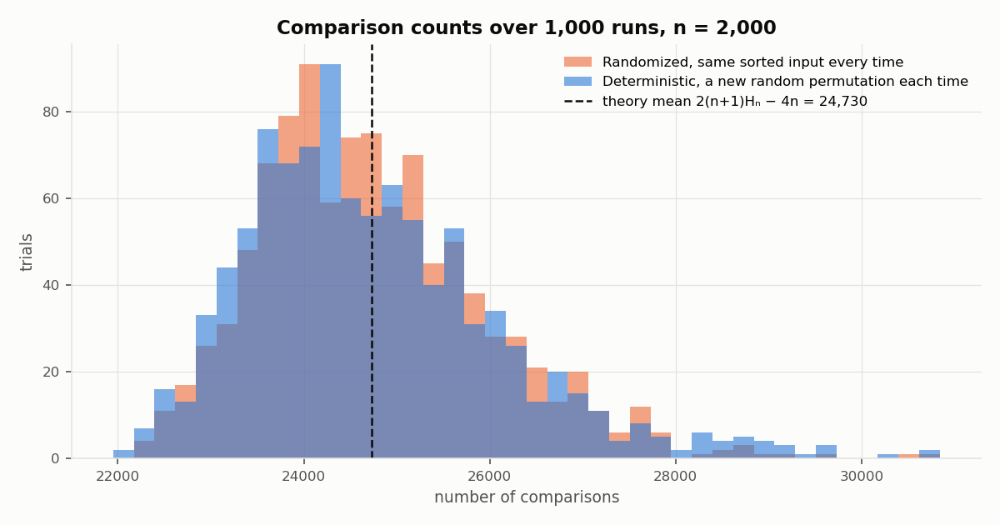

# Quicksort: Implementation, Analysis, and Randomization

MSCS532 Assignment 5

All measurements were taken with Python 3.13.9 on an Apple Silicon Mac. Every number
quoted below comes from [`results/benchmark_output.txt`](results/benchmark_output.txt),
which `python3 run_benchmarks.py` regenerates. Comparison counts, recursion depths and the
Part 3 distribution are seeded (seed 532), so they reproduce exactly; wall-clock times vary
by a few percent from run to run.

## Contents

1. [Implementation](#1-implementation)
2. [Performance analysis](#2-performance-analysis)
3. [Randomized Quicksort](#3-randomized-quicksort)
4. [Empirical analysis](#4-empirical-analysis)
5. [Conclusions](#5-conclusions)
6. [References](#6-references)

---

## 1. Implementation

File: [`quicksort.py`](quicksort.py). The code follows QUICKSORT, PARTITION and
RANDOMIZED-QUICKSORT from Cormen et al. (2022, ch. 7), using 0-based inclusive ranges
`arr[lo..hi]`.

| Function | Pivot | Partition |
|---|---|---|
| `quicksort(arr)` | last item `arr[hi]` | Lomuto (`partition`) |
| `randomized_quicksort(arr, rng=None)` | uniformly random item of `arr[lo..hi]` | Lomuto, after swapping the random item to `arr[hi]` (`randomized_partition`) |
| `randomized_quicksort_3way(arr, rng=None)` | uniformly random item | Dijkstra three-way (`three_way_partition`): `< pivot`, `== pivot`, `> pivot` |

The third version is an extension beyond the assignment. Section 4.4 shows that the
first two degrade to Θ(n²) on inputs with many equal keys, whatever the pivot rule, and the
three-way version shows how to fix that.

### 1.1 The three steps

Quicksort is divide and conquer:

1. **Divide.** Pick a pivot and rearrange `arr[lo..hi]` so that everything left of the
   pivot's final index `p` is `<=` the pivot and everything right of it is `>` the pivot.
2. **Conquer.** Sort `arr[lo..p-1]` and `arr[p+1..hi]` recursively.
3. **Combine.** Nothing to do. Both sides are sorted in place and already in the right
   order relative to each other.

### 1.2 Lomuto partition

```python
def partition(arr, lo, hi):
    pivot = arr[hi]
    i = lo - 1
    for j in range(lo, hi):
        if arr[j] <= pivot:
            i += 1
            arr[i], arr[j] = arr[j], arr[i]
    arr[i + 1], arr[hi] = arr[hi], arr[i + 1]
    return i + 1
```

The loop keeps this invariant at the top of each pass:

```
 lo        i  i+1       j-1  j             hi
 [  <= pivot ][  > pivot    ][ unexamined   ][pivot]
```

When the loop ends, the unexamined region is empty, and one swap moves the pivot between the
two groups. The loop makes exactly `hi - lo` comparisons, so one call on n items costs Θ(n)
time and O(1) extra space.

### 1.3 Randomized partition

```python
def randomized_partition(arr, lo, hi, rng=random):
    k = rng.randint(lo, hi)
    arr[k], arr[hi] = arr[hi], arr[k]
    return partition(arr, lo, hi)
```

One extra random number and one swap per partition call. Everything else is shared with the
deterministic version, so the timing comparison in Section 4 isolates the effect of the pivot
rule.

### 1.4 Design choices

* **Recurse into the smaller side, loop on the larger.** The textbook procedure makes two
  recursive calls. On sorted input every split is (n−1, 0), so the call stack would reach n
  levels and Python would raise `RecursionError` at about 1,000. The drivers `_quicksort`
  and `_quicksort_3way` recurse only into the smaller part and continue the `while` loop on
  the larger part (CLRS problem 7-4). The partitions performed, and so the comparisons and
  running time, are identical to the textbook version. Only the stack depth changes, from
  O(n) to O(lg n) in the worst case. Without this, the Θ(n²) worst case could not be measured
  beyond n ≈ 1,000.
* **In place, returning the list.** All versions sort the list they are given and return it,
  so `quicksort(data[:])` works like `sorted(data)`.
* **Only comparison operators are used** (`<=` for Lomuto, `<` for three-way), so any
  mutually comparable values can be sorted. This also let the benchmark count comparisons by
  wrapping values in a class whose comparison methods increment a counter.
* **Optional `rng` argument** for the randomized versions. Passing `random.Random(seed)`
  makes a run reproducible, which the tests and Part 3 of the benchmark rely on.
* **Optional `QuickSortStats` argument** records the number of partition calls, the deepest
  level of the recursion tree (`max_depth`, the stack depth the textbook version would
  need) and the deepest real Python stack (`max_stack`). It is checked once per partition
  call, not once per comparison, so it costs almost nothing.

### 1.5 Testing

[`test_quicksort.py`](test_quicksort.py) has 13 tests (`python3 -m unittest -v
test_quicksort`). They check:

* all three sorts against `sorted()` on edge cases (empty, one item, all equal, negatives,
  floats), 18 random lists, a list with only 4 distinct values, and a nearly-sorted list;
* strings and tuples;
* that the list is sorted in place and returned;
* the partition postconditions and that partitioning only moves items within `arr[lo..hi]`;
* that the random pivot's rank is uniform (20,000 trials, each rank within 1.5% of 1/10);
* that deterministic Quicksort on sorted input makes exactly n − 1 partition calls with a
  recursion tree n − 2 deep, while the real stack stays at 1 frame;
* that the real stack depth never exceeds lg n + 1 for n = 4,096;
* that 5,000 sorted items do not overflow Python's recursion limit;
* that on all-equal input two-way partitioning needs n − 1 partitions and three-way needs 1.

---

## 2. Performance analysis

Let T(n) be the running time on n items. The cost of one level of recursion is the
partitioning: Θ(m) for a subarray of m items. Let C(n) be the number of key comparisons.
Because each partition of m items makes exactly m − 1 comparisons, C(n) tracks T(n) up to
constant factors, and it is the measure used in the analysis below.

### 2.1 Worst case: Θ(n²)

The worst case is when every partition is as unbalanced as possible, with the pivot being the
smallest or largest item, giving sides of n − 1 and 0:

$$
T(n) = T(n-1) + T(0) + \Theta(n) = T(n-1) + \Theta(n)
\;\Rightarrow\; T(n) = \sum_{m=1}^{n} \Theta(m) = \Theta(n^2).
$$

Counting comparisons exactly:

$$
C(n) = (n-1) + (n-2) + \dots + 1 = \frac{n(n-1)}{2}.
$$

With the last-item pivot this happens on **already-sorted** input (the pivot is always the
maximum) and on **reverse-sorted** input. In the reverse case the first call puts the
minimum at the front and moves the maximum to the end, so the next pivot is the maximum, and
the splits alternate between (0, n−1) and (n−1, 0). The measured counts at n = 4,000 are
exactly n(n−1)/2 = 7,998,000 for both (Section 4.2).

An upper bound of O(n²) holds for every input. The recursion tree has at most n − 1
partition nodes, and each costs at most n.

### 2.2 Best case: Θ(n lg n)

The best case is when every pivot is the median, giving sides of ⌊(n−1)/2⌋ and
⌈(n−1)/2⌉:

$$
T(n) = 2T(n/2) + \Theta(n) \;\Rightarrow\; T(n) = \Theta(n \lg n)
$$

by case 2 of the master theorem. The recursion tree has lg n levels, and each level
partitions a total of at most n items.

The split does not have to be perfect. Any split of constant proportion, even 9-to-1, gives

$$
T(n) = T(9n/10) + T(n/10) + \Theta(n).
$$

Every level still costs at most cn, and the deepest path has length
log<sub>10/9</sub> n = Θ(lg n), so T(n) = O(n lg n). Only splits whose smaller side is a
vanishing fraction of n, like (n−1, 0), cause quadratic behaviour.

No comparison sort can do better than Ω(n lg n) in the worst case, because a decision tree
with n! leaves has height at least lg(n!) = Θ(n lg n). So the best case is Θ(n lg n).

### 2.3 Average case: Θ(n lg n)

Assume the keys are distinct and every input permutation is equally likely, or, equivalently
(Section 3), that the pivot is chosen at random. Rename the keys in sorted order as
z<sub>1</sub> < z<sub>2</sub> < … < z<sub>n</sub>, and let Z<sub>ij</sub> =
{z<sub>i</sub>, …, z<sub>j</sub>}.

**Key observation.** Two keys are compared only when one of them is the current pivot, and a
pivot is never compared again after its partition. So z<sub>i</sub> and z<sub>j</sub> are
compared at most once. They are compared exactly when the first pivot chosen from Z<sub>ij</sub>
is z<sub>i</sub> or z<sub>j</sub>. If some z<sub>k</sub> with i < k < j is picked first, it
sends z<sub>i</sub> and z<sub>j</sub> to opposite sides and they never meet. Until a pivot from
Z<sub>ij</sub> is chosen, all of Z<sub>ij</sub> stays in the same subarray, and each of its
j − i + 1 keys is equally likely to be picked first. Therefore

$$
\Pr[z_i \text{ is compared with } z_j] = \frac{2}{j-i+1}.
$$

**Summing with indicator random variables.** Let X<sub>ij</sub> = 1 if z<sub>i</sub> and
z<sub>j</sub> are compared. By linearity of expectation, with k = j − i,

$$
E[C(n)] = \sum_{i=1}^{n-1}\sum_{j=i+1}^{n} \frac{2}{j-i+1}
= \sum_{i=1}^{n-1}\sum_{k=1}^{n-i} \frac{2}{k+1}
< \sum_{i=1}^{n} 2H_n = 2nH_n = O(n \lg n),
$$

where H<sub>n</sub> = 1 + 1/2 + … + 1/n = ln n + O(1). Evaluating the sum exactly gives

$$
E[C(n)] = 2(n+1)H_n - 4n \;\approx\; 2n\ln n \;\approx\; 1.386\, n \lg n.
$$

The same result comes from the recurrence. The pivot's rank is uniform on 1..n, so

$$
E[C(n)] = (n-1) + \frac{1}{n}\sum_{k=0}^{n-1}\big(E[C(k)] + E[C(n-1-k)]\big)
= (n-1) + \frac{2}{n}\sum_{k=0}^{n-1} E[C(k)],
$$

whose solution is 2(n+1)H<sub>n</sub> − 4n. Together with the Ω(n lg n) lower bound, the
average case is Θ(n lg n). It is only about 39% above the best case of about n lg n
comparisons.

**Why the average is so close to the best case.** A pivot whose rank falls in the middle half
gives a split no worse than 3-to-1, and that happens with probability 1/2. So on average every
other partition is "good". A good split shrinks the subarray to at most 3/4 of its size, so
any root-to-leaf path contains at most log<sub>4/3</sub> n good splits. That puts the expected
depth at O(lg n), and each level costs O(n). Bad splits in between only add a constant factor;
a bad split followed by a good one costs about the same as a single good split.

**Check against the measurements.** At n = 2,000 the formula predicts 24,730 comparisons. The
mean over 1,000 runs was 24,747 for randomized Quicksort and 24,736 for deterministic
Quicksort on random permutations (Section 4.3).

### 2.4 Summary of time complexity

| Case | Deterministic (last-item pivot) | Randomized | Input that causes it (deterministic) |
|---|---|---|---|
| Best | Θ(n lg n) | Θ(n lg n) | every pivot is the median |
| Average / expected | Θ(n lg n), about 1.39 n lg n comparisons | Θ(n lg n) expected **on every input** | random permutation |
| Worst | Θ(n²), exactly n(n−1)/2 comparisons | Θ(n²), with probability → 0 | sorted, reverse-sorted |
| Many equal keys (k distinct values) | Θ(n²/k) | Θ(n²/k) | e.g. k = 10 → n²/20 |

### 2.5 Space complexity and other overheads

**Extra memory for the data: O(1).** Partitioning swaps items within the input list and uses
a constant number of index variables. No auxiliary array is allocated, unlike Merge Sort's
Θ(n) buffer.

**Call stack: the main space cost.**

| Version | Worst-case stack depth | Expected stack depth |
|---|---|---|
| Textbook (recurse into both sides) | Θ(n), e.g. sorted input with the last-item pivot | Θ(lg n) |
| This implementation (recurse into the smaller side) | ⌊lg n⌋ + 1 | ≤ ⌊lg n⌋ + 1 |

The bound for the smaller-side version follows because each recursive call gets at most half
of its parent's items, so after d nested calls at most n/2<sup>d</sup> items are left, and
d ≤ lg n. The measurements agree. The deepest real stack over 20 trials at n = 131,072 was 12
frames (lg n = 17). The recursion *tree*, which is what the textbook version would put on the
stack, was on average 39.9 levels deep for randomized Quicksort and n − 2 = 131,070 levels
for deterministic Quicksort on sorted input (Section 4.5).

**Other overheads.**

* *Function calls.* There is one Python call per partition, about 0.67n calls on random
  input (2,663 partitions for n = 4,000). This is cheap next to the Θ(n lg n) comparisons
  but not free in Python.
* *Random numbers.* Randomized Quicksort makes one `randint` call per partition. On random
  input, where the pivot rule makes no difference, this made it about 15–30% slower than the
  deterministic version (e.g. 116.7 vs 91.1 ms at n = 128,000).
* *Swaps.* Lomuto does about as many swaps as there are items `<=` the pivot, about three
  times more than Hoare's partition on random data. This matters less in Python, where
  interpreter overhead dominates, than in C.
* *Cache behaviour.* Partitioning scans the subarray left to right, so memory access is
  sequential and cache-friendly. This is a large reason Quicksort beats Heapsort in practice
  in compiled languages.
* *Not stable.* Partitioning swaps items over long distances, so equal keys can change
  relative order.

---

## 3. Randomized Quicksort

### 3.1 What randomization changes

The deterministic algorithm's running time depends on the **input**. The randomized
algorithm's running time depends on its own **coin flips**. The randomized algorithm has no
bad input, only bad luck, and bad luck is extremely rare.

For distinct keys, running randomized Quicksort on any fixed input gives exactly the same
distribution of running times as running deterministic Quicksort on a uniformly random
permutation. In both cases, every key in a subarray is equally likely to be the pivot,
independently at every step. So the average-case analysis of Section 2.3 becomes an
*expected-time guarantee for every input*:

$$
E[C(n)] = 2(n+1)H_n - 4n = \Theta(n \lg n) \quad\text{for every input of } n \text{ distinct keys}.
$$

Part 3 of the benchmark tests this directly (Section 4.3). It ran randomized Quicksort 1,000
times on the same sorted list and deterministic Quicksort on 1,000 random permutations.
The histograms coincide.

### 3.2 Why the worst case becomes unlikely

The worst case still exists. If every random pivot happens to be the minimum or maximum of
its subarray, randomized Quicksort makes n(n−1)/2 comparisons. But this requires a
specific sequence of choices. At each of the n − 1 partitions, the pivot has to be one of
the two extremes out of m items, which has probability 2/m:

$$
\Pr[\text{every split is } (m-1, 0)] = \prod_{m=2}^{n} \frac{2}{m} = \frac{2^{n-1}}{n!}.
$$

For n = 20 this is 2.2 × 10⁻¹³, and for n = 100 it is 6.8 × 10⁻¹²⁹.

More importantly, even *moderately* bad behaviour is unlikely. The number of comparisons
is tightly concentrated around its mean. Its variance is known exactly in the limit
(Sedgewick & Flajolet, 2013):

$$
\operatorname{Var}[C(n)] \sim \left(7 - \tfrac{2\pi^2}{3}\right) n^2 \approx 0.42\,n^2,
\qquad \sigma \approx 0.648\,n.
$$

The standard deviation grows like n, but the mean grows like n lg n, so the *relative*
spread σ/E[C] → 0. Chebyshev's inequality already gives, for n = 2,000,

$$
\Pr\big[C(n) \ge 2\,E[C(n)]\big] \le \frac{\operatorname{Var}[C(n)]}{E[C(n)]^2} \approx 0.0027,
$$

and that is a very loose bound. Sharper analyses show that randomized Quicksort runs in
O(n lg n) time with high probability, with the chance of exceeding c·n lg n falling
polynomially in n as c grows (Motwani & Raghavan, 1995, ch. 4). In 1,000 measured runs at
n = 2,000, the *worst* run used 30,842 comparisons, only 1.25× the mean. The deterministic
version on sorted input used 1,999,000, 81× the mean.

### 3.3 What randomization does not fix

* **Expected cost on random input is unchanged.** On a random permutation, both versions
  make the same expected number of comparisons. Randomization only adds the `randint` cost
  there.
* **Duplicate keys.** If many keys are equal, Lomuto partitioning sends all of them to the
  left side. A subarray of m equal keys splits as (m−1, 0) **no matter which item is the
  pivot**, so it costs m(m−1)/2 comparisons. With k distinct values each occurring n/k times,
  the total is about k · (n/k)²/2 = n²/(2k). For the "few-unique" input (k = 10, n = 4,000)
  that predicts 800,000 comparisons. The measurements were 815,613 (deterministic) and 817,078
  (randomized). The extra 2% is the n lg k work of separating the 10 values. The fix is to
  change the *partition*, not the pivot rule. Three-way partitioning puts all keys equal to
  the pivot in a middle block that is never touched again, which needed only 23,847
  comparisons on the same input.
* **Adversaries who can see the random numbers.** If an attacker can predict the random
  generator, for example a fixed seed in a web service, they can construct a bad input. This
  is why production libraries use non-deterministic seeds or fall back to a guaranteed
  O(n lg n) algorithm, as introsort does.

---

## 4. Empirical analysis

### 4.1 Setup

[`run_benchmarks.py`](run_benchmarks.py) generates five input distributions:

| Input | Construction | Why it is included |
|---|---|---|
| random | random permutation of 0..n−1 | average case; all keys distinct |
| sorted | 0, 1, …, n−1 | worst case for the last-item pivot |
| reverse | n, n−1, …, 1 | also a worst case |
| nearly-sorted | sorted, then n/100 random pairs swapped | common in practice (appending to sorted data) |
| few-unique | random integers in 0..9 | many duplicate keys |

Sizes double from 1,000 to 128,000. Each timing is the median of 5 runs on fresh copies,
with garbage collection disabled while timing. Quadratic cases quickly get slow, so a run
longer than 0.25 s is timed only once, and a series stops after a run longer than 2 s. The
remaining sizes are shown as "skipped". Every result is checked against `sorted()`.

### 4.2 Running time

Median time in ms:

| n | random: Det | random: Rand | sorted: Det | sorted: Rand | reverse: Det | reverse: Rand |
|---:|---:|---:|---:|---:|---:|---:|
| 1,000 | 0.5 | 0.6 | 15.9 | 0.5 | 11.6 | 0.6 |
| 4,000 | 2.1 | 2.6 | 268.9 | 2.5 | 184.9 | 2.5 |
| 16,000 | 9.0 | 11.9 | 4,507.6 | 11.3 | 3,081.9 | 11.0 |
| 64,000 | 42.8 | 53.6 | *skipped* | 48.9 | *skipped* | 48.9 |
| 128,000 | 91.1 | 116.7 | *skipped* | 99.9 | *skipped* | 101.8 |

| n | nearly-sorted: Det | nearly-sorted: Rand | few-unique: Det | few-unique: Rand | few-unique: 3-way |
|---:|---:|---:|---:|---:|---:|
| 1,000 | 1.6 | 0.6 | 1.9 | 2.1 | 0.2 |
| 4,000 | 26.1 | 2.5 | 26.6 | 27.9 | 0.6 |
| 16,000 | 31.8 | 10.9 | 408.7 | 410.4 | 2.5 |
| 64,000 | 364.5 | 48.9 | 6,638.6 | 6,451.6 | 10.4 |
| 128,000 | 915.5 | 99.7 | *skipped* | *skipped* | 20.2 |

The growth rate is easiest to read from the average ratio t(2n)/t(n). It should be about 2.1
for n lg n over this range and 4.0 for n²:

| Input | Deterministic | Randomized | Randomized 3-way |
|---|---:|---:|---:|
| random | 2.15 | 2.15 | 2.13 |
| sorted | **4.11** | 2.09 | 2.12 |
| reverse | **4.04** | 2.09 | 2.14 |
| nearly-sorted | 2.51 | 2.09 | 2.13 |
| few-unique | **3.93** | **3.81** | 2.01 |


*Each panel is log–log, so a straight line of slope 1 is about n lg n and slope 2 is n². The
dotted and dashed grey lines are n lg n and n² references. The bottom-right panel shows
comparisons divided by n lg n at n = 4,000 on a log scale, with the dotted line at the
theoretical 1.149 for random input.*

### 4.3 Comparisons

Comparison counts at n = 4,000 (n lg n = 47,863; theory: n(n−1)/2 = 7,998,000 and
2(n+1)H<sub>n</sub> − 4n = 54,989):

| Input | Deterministic | Randomized | Randomized 3-way |
|---|---:|---:|---:|
| random | 54,238 (1.13 n lg n) | 52,312 (1.09) | 83,613 (1.75) |
| sorted | **7,998,000** (167) | 53,486 (1.12) | 89,582 (1.87) |
| reverse | **7,998,000** (167) | 56,587 (1.18) | 82,835 (1.73) |
| nearly-sorted | 396,200 (8.28) | 54,021 (1.13) | 83,780 (1.75) |
| few-unique | 815,613 (17.0) | 817,078 (17.1) | **23,847** (0.50) |

The distribution of comparisons over 1,000 runs at n = 2,000:

| | mean | sd | min | max | max / mean |
|---|---:|---:|---:|---:|---:|
| Theory | 24,730 | ≈ 1,297 | | | |
| Randomized, the same sorted input every run | 24,747 | 1,237 | 22,223 | 30,842 | 1.25 |
| Deterministic, a new random permutation every run | 24,736 | 1,375 | 21,951 | 30,730 | 1.24 |
| Deterministic, sorted input | 1,999,000 | – | | | 81 |



### 4.4 Discussion

**Random input: both are Θ(n lg n), and deterministic is a little faster.** The two versions
make statistically identical numbers of comparisons (1.09–1.13 n lg n against a theoretical
1.15 at n = 4,000). Both grow by about 2.15× per doubling of n. The randomized version is
consistently 15–30% slower in wall-clock time. That overhead is the `random.randint` call and
extra swap in every partition, about 0.67n of them, and is pure cost when the input is
already random. This agrees with the theory: randomization does not improve the average
case, it only makes it the expected case for every input.

**Sorted and reverse-sorted: the worst case appears exactly as predicted.** Deterministic
Quicksort made exactly n(n−1)/2 comparisons, its time grew 4.1× and 4.0× per doubling, and at
n = 16,000 it took 4.5 s on sorted input against 11 ms for the randomized version, a factor of
about 400. Extrapolating by 4× per doubling, n = 128,000 would take about 4.5 s × 4³ ≈ 5 minutes.
The randomized version ran in the same time on sorted, reverse and random input (about 100 ms
at n = 128,000), and its comparison count stayed between 1.09 and 1.18 n lg n regardless of
input order. That is the "no bad inputs" property of Section 3.1.

Reverse-sorted input is about 30% faster than sorted input for the deterministic version,
even though both make exactly the same number of comparisons. With sorted input every
`arr[j] <= pivot` test is true, so every iteration also performs a swap. With reverse input,
half of the partitions have a pivot that is the minimum, where the test is always false and
no swaps happen. This is a reminder that comparisons are a good model for growth rate but not
for constant factors.

**Nearly-sorted input: no longer the worst case, but far from average.** With 1% of positions
disturbed, deterministic Quicksort made 8.3 n lg n comparisons, 7× more than randomized. Most
of the time the last item of a subarray is still close to its maximum, so splits are very
lopsided. When a displaced item happens to be the pivot, it breaks the chain with a more
balanced split. That makes the behaviour irregular. The time barely moved from 8,000 to
16,000 and then grew about 3× per doubling, but it is always much slower than randomized.
Real data is often nearly sorted, for example log files or a sorted table with a few
appended rows. This case shows why a fixed pivot position is risky in practice, not only for
contrived inputs.

**Few-unique input: randomization does not help.** Both two-way versions ran in quadratic
time (3.9× and 3.8× per doubling, 6.5 s at n = 64,000), with nearly identical comparison
counts that match the n²/20 prediction of Section 3.3. The three-way version sorted the same
input in 10 ms. It made only 0.5 n lg n comparisons, because after the 10 distinct values are
separated, there is nothing left to sort. On distinct keys, three-way partitioning costs
about 1.6× as many comparisons (each item may be compared with the pivot twice), which made
it about 40–65% slower than the two-way randomized version. It trades a constant factor in
the common case for removing a quadratic case.

### 4.5 Recursion depth

Randomized Quicksort on sorted input, 20 trials per size:

| n | lg n | mean recursion-tree depth | max over trials | max real stack | deterministic tree depth |
|---:|---:|---:|---:|---:|---:|
| 256 | 8 | 14.6 | 19 | 5 | 254 |
| 4,096 | 12 | 25.2 | 29 | 8 | 4,094 |
| 131,072 | 17 | 39.9 | 46 | 12 | 131,070 |


The randomized recursion tree grows like Θ(lg n), at about 2.3 lg n, and stays below the
asymptotic 4.311 ln n expected height of a random binary search tree (Devroye, 1986). The
recursion tree of randomized Quicksort has the same distribution as a random BST. The real
call stack, with smaller-side recursion, never exceeded lg n. The deterministic tree on
sorted input is n − 2 levels deep. A textbook implementation in Python would crash with
`RecursionError` at n ≈ 1,000 on sorted input, while this one used one stack frame, because
the empty side is always the one it recurses into.

### 4.6 Theory vs. measurement

| Prediction (Sections 2–3) | Observed |
|---|---|
| Worst case n(n−1)/2 comparisons on sorted/reverse input | exactly 499,500 (n = 1,000) and 7,998,000 (n = 4,000) |
| Worst-case time Θ(n²) → ×4 per doubling | ×4.11 (sorted), ×4.04 (reverse) |
| Average/expected time Θ(n lg n) → ×2.1 per doubling | ×2.08–2.15 for both versions on random input, and for randomized on every distinct-key input |
| Expected comparisons 2(n+1)H<sub>n</sub> − 4n = 24,730 at n = 2,000 | mean 24,747 (randomized), 24,736 (deterministic on random input) |
| Randomized on any input ≡ deterministic on a random permutation | the two 1,000-run histograms coincide |
| σ ≈ 0.648n = 1,297 | 1,237 and 1,375 |
| Many equal keys: about n²/(2k) comparisons for both two-way versions | 815,613 / 817,078 vs. 800,000 predicted |
| Smaller-side recursion: stack ≤ lg n + 1 | max 12 frames at n = 131,072 (lg n = 17) |
| Randomized recursion depth Θ(lg n) | 14.6 → 39.9 as n grows 512× (about 2.3 lg n) |

---

## 5. Conclusions

1. **Quicksort is Θ(n lg n) on average and Θ(n²) in the worst case.** Which one you get
   depends entirely on the balance of the splits. Any split of constant proportion gives
   n lg n; only splits that peel off a vanishing fraction, like (n−1, 0), give n².
2. **A fixed pivot position makes common inputs the worst case.** Sorted, reverse-sorted and
   nearly-sorted data are exactly what real systems tend to produce. The deterministic
   version was 400× slower than randomized on 16,000 sorted items.
3. **A random pivot moves the uncertainty from the input to the algorithm.** Every input then
   has expected cost 2(n+1)H<sub>n</sub> − 4n ≈ 1.39 n lg n comparisons, and the cost is
   tightly concentrated. The worst of 1,000 runs was only 25% above the mean. The price is
   one random number per partition, about 15–30% in Python on input that was already random.
4. **Randomization does not fix duplicate keys.** That needs a different partition. Three-way
   partitioning turned a 6.5 s sort into a 10 ms one.
5. **Space is O(lg n) only with care.** Recursing into the smaller side bounds the stack at
   lg n regardless of pivot luck. This matters in Python, where deep recursion crashes, and in
   any memory-constrained setting.

In practice this is why library sorts built on Quicksort combine these ideas: random or
median-of-three pivots, three-way or "fat" partitioning for duplicates, smaller-side
recursion, and a fallback to Heapsort when recursion goes too deep (introsort, used in C++
`std::sort`; pattern-defeating Quicksort in Rust and Go).

---

## 6. References

* Cormen, T. H., Leiserson, C. E., Rivest, R. L., & Stein, C. (2022). *Introduction to
  Algorithms* (4th ed.). MIT Press. Chapter 7 (Quicksort), Section 8.1 (lower bound for
  comparison sorting), Section 4.5 (master theorem), Problem 7-4 (stack depth).
* Sedgewick, R., & Flajolet, P. (2013). *An Introduction to the Analysis of Algorithms* (2nd
  ed.). Addison-Wesley. Chapter 1 (Quicksort mean and variance).
* Motwani, R., & Raghavan, P. (1995). *Randomized Algorithms*. Cambridge University Press.
  Chapter 4 (high-probability bounds for randomized Quicksort).
* Devroye, L. (1986). A note on the height of binary search trees. *Journal of the ACM,
  33*(3), 489–498.
* Bentley, J. L., & McIlroy, M. D. (1993). Engineering a sort function. *Software: Practice
  and Experience, 23*(11), 1249–1265. (Three-way partitioning for equal keys.)
* Musser, D. R. (1997). Introspective sorting and selection algorithms. *Software: Practice
  and Experience, 27*(8), 983–993.
